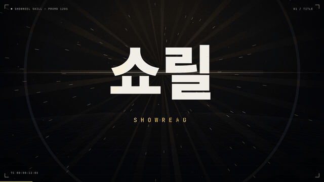
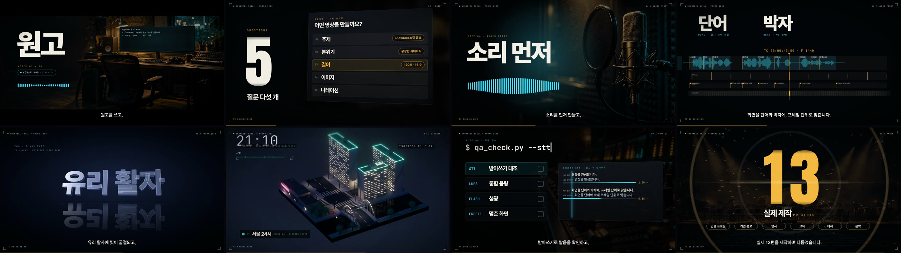
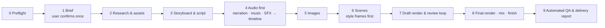

<div align="center">

# showreel

**A Claude Code skill that produces Korean motion-graphics videos from a single request — brief, research, script, narration, music, images, render, mix and QA.**

[English](README.md) · [한국어](README.ko.md)

[](LICENSE)
[](https://docs.claude.com/en/docs/claude-code/skills)
[](#requirements)
[](https://www.python.org/)
[](https://nodejs.org/)
[](https://github.com/revfactory/showreel/releases)

<a href="https://github.com/revfactory/showreel/releases/download/v1.0.0/showreel-promo-120s.mp4">
  
</a>

<sub>Highlights from a 2-minute promo for showreel, made with this skill. The full video below has sound.</sub>

</div>

---

## Demo

The full 2-minute video was produced by this skill from one prompt: four ElevenLabs voices, generated music, sound effects, AI images, 22 motion techniques and an automated QA pass.

<!-- DEMO_VIDEO -->

**[▶ Download the full demo (1080p, 2:00, 31 MB)](https://github.com/revfactory/showreel/releases/download/v1.0.0/showreel-promo-120s.mp4)**

<p align="center">
  
</p>

## 한국어 소개

**showreel**은 Claude Code에서 한국어 모션그래픽 영상을 만드는 스킬입니다. "60초 회사 소개 영상 만들어줘"처럼 요청하면 Claude가 주제·분위기·길이·이미지·나레이션을 한 번 묻고, 그다음부터는 묻지 않고 납품까지 진행합니다. 조사, 원고, ElevenLabs 나레이션, 음악과 효과음, 이미지 생성, HTML 모션 엔진 렌더, 믹스, 자동 검수를 모두 거칩니다.

화면 전환은 나레이션 단어와 음악 박자에 프레임 단위로 맞춥니다. 완성본은 받아쓰기(STT)로 발음을 다시 확인하고, 음량·섬광·멈춘 화면을 검사한 뒤 납품합니다. 인물 프로필, 기업 홍보, 행사, 교육, 티저, 음악 기반 영상 등 실제 제작 13건에서 쓴 방법을 스크립트와 문서로 정리했습니다.

자세한 설명은 [한국어 README](README.ko.md)에 있습니다.

## Table of contents

- [Demo](#demo)
- [Overview](#overview)
- [Features](#features)
- [How it works](#how-it-works)
- [Requirements](#requirements)
- [Installation](#installation)
- [Quick start](#quick-start)
- [Defaults](#defaults)
- [Script reference](#script-reference)
- [Repository layout](#repository-layout)
- [Configuration](#configuration)
- [Troubleshooting](#troubleshooting)
- [Limitations](#limitations)
- [Contributing](#contributing)
- [Security](#security)
- [License](#license)
- [Acknowledgments](#acknowledgments)

## Overview

`showreel` is an [Agent Skill](https://docs.claude.com/en/docs/claude-code/skills) for Claude Code. It turns a short request such as *"Make a 60-second promo for our product launch, cinematic, with narration"* into a finished, delivery-ready video:

- a master MP4 and a lighter MP4 for sharing,
- a poster JPG and an SRT subtitle file,
- a production note listing sources, settings, open checks and the commands to regenerate every asset.

The target is a motion designer's showreel, not a slideshow: a strong visual event in the first three seconds, one message per screen, and every cut placed on a narration word or a music hit.

The skill is written for Korean content (Korean typography, Korean narration and pronunciation rules), but the engine, renderer and audio tools are language-neutral.

## Features

| Area | What the skill does |
| --- | --- |
| **Brief** | Asks up to eight questions once (topic, mood, length, aspect ratio, images, narration, must-have facts, asset locations), then runs to delivery without further questions. |
| **Research** | Runs a background research agent. Every fact in the video needs a source URL and a confidence level; dates are checked against the calendar. |
| **Script** | Separates on-screen text from pronunciation text, sizes the script to the length (60 s ≈ 240–255 Korean characters) and names cue words for scene changes. |
| **Narration** | ElevenLabs TTS (default voice: Marcus, deep baritone) with per-line takes, regeneration of changed lines only, and STT verification of every line. |
| **Music & SFX** | ElevenLabs Music planned in 4-bar sections, beat/hit analysis and splicing to move a drop; a NumPy synthesizer as a fallback; a 24-preset SFX kit. |
| **Images** | Generates only the scenes that need images with [codex-image](https://github.com/revfactory/skills), plus letterbox removal, upscaling and macOS Vision cutouts. Real people are never generated. |
| **Motion engine** | A deterministic HTML/JS timeline (`REEL`): every frame is a pure function of time, so frames can be rendered in any order by parallel workers. |
| **Techniques** | A catalog of 22 techniques with code: isometric voxel city, Hangul jamo assembly, variable-weight waves, glass type, prism light, beat grids, mechanical counters, 3D device UI, particle type, match cuts and more. |
| **Rendering** | Playwright + system Chrome, sub-frame motion blur (180° shutter), resumable chunks, BT.709 `yuv420p` TV-range output. |
| **Mix & master** | Speech-band ducking, per-line "narration vs. bed" report, two-pass loudnorm to −14 LUFS with true-peak headroom. |
| **Automated QA** | Spec, loudness, dark segments, photosensitive flashes, frozen frames, low-motion warnings and STT of the final mix, written to `qa/qa_report.md`. |

## How it works



Audio is produced before the picture. `timeline.py` converts narration word timings and music hits into named cues, and scenes read those cues with `REEL.cue('name')` instead of hard-coded seconds. When a narration line is regenerated, the picture follows without edits.

Long-running steps (research, TTS, music, image generation, final render) run in the background while Claude continues with the next step.

## Requirements

| Tool | Required | Used for |
| --- | --- | --- |
| [Claude Code](https://docs.claude.com/en/docs/claude-code/overview) | Yes | Runs the skill |
| macOS | Recommended | Tested platform. Linux works for rendering and audio with `REEL_CHROME_PATH`; cutouts need macOS |
| Python 3.10+ with `numpy` and `Pillow` | Yes | Timeline, mix, QA, image prep, synthesizer |
| Node.js 20+ | Yes | Renderer (`playwright-core`) |
| Google Chrome (or Chromium) | Yes | Headless rendering. No browser download needed |
| ffmpeg with `loudnorm`, `ebur128`, `freezedetect`, `signalstats`, `tmix` | Yes | Encoding, loudness, QA |
| [ElevenLabs](https://elevenlabs.io) API key | For narration | TTS, STT verification, SFX. **Music requires a paid plan**; library voices such as Marcus are not available on the Free plan |
| [Codex CLI](https://github.com/openai/codex) + [codex-image](https://github.com/revfactory/skills) skill | Optional | AI image generation. Without it, videos use typography, graphics and your own photos |
| [photoreal](https://github.com/revfactory/skills) skill | Optional | Prompt design for photographic images with people |
| Xcode command line tools (`swiftc`) | Optional | Person cutouts with macOS Vision |

Korean fonts (Pretendard and Google Fonts families, all SIL OFL) are copied from your system or downloaded per project by `new_project.py`. No fonts are bundled in this repository.

## Installation

**1. Clone into your Claude Code skills folder**

```bash
# Personal skill (available in every project)
git clone https://github.com/revfactory/showreel.git ~/.claude/skills/showreel

# Or project skill (shared with your team through the repository)
git clone https://github.com/revfactory/showreel.git .claude/skills/showreel
```

**2. Install dependencies**

```bash
brew install ffmpeg node
python3 -m pip install numpy pillow
cd ~/.claude/skills/showreel/scripts && npm install
```

**3. Set your ElevenLabs API key** (needed for narration)

```bash
echo 'export ELEVENLABS_API_KEY="sk_..."' >> ~/.zshrc && source ~/.zshrc
```

You can also put `ELEVENLABS_API_KEY=sk_...` in a `.env` file in the project folder.

**4. Check the environment**

```bash
python3 ~/.claude/skills/showreel/scripts/preflight.py
```

The preflight report lists each tool as ✓ or ✗, prints the install command for anything missing, and shows which production paths are available (narration, music API, image generation).

## Quick start

Open Claude Code in an empty folder and describe the video. The skill triggers on requests such as "showreel", "motion graphics", "promo video", "teaser", "60-second video", or by typing `/showreel`.

```text
/showreel 우리 팀이 만든 사내 검색 서비스 소개 60초 영상. 웅장한 분위기, 나레이션 넣어 줘.
```

```text
Make a 30-second product teaser in Korean, tech keynote style, music and typography only, no narration.
```

Claude asks the brief questions once, shows a one-paragraph summary with the estimated time and credits, and continues after you confirm. Say "don't ask, just go" to skip the questions and use the defaults.

A finished project looks like this:

```text
my-promo/
├── brief.md, storyboard.md, script.json, timeline.json
├── research/        research.md (facts with sources), photos.md
├── audio/           vo/ (narration takes), music/, sfx/, mix.wav
├── assets/          gen/ (generated images), img/ (processed)
├── reel/            index.html, engine.js, fx.js, timeline.js, scenes.js, fonts/
├── qa/              stills, contact sheets, qa_report.md
├── out/             <title>.mp4, <title>_공유용.mp4, poster, .srt
└── 제작노트.md       production note
```

## Defaults

Anything you do not specify uses these values.

| Setting | Default |
| --- | --- |
| Length & format | 60 s, 16:9, 1920×1080, 30 fps (15 s / 30 s / 60 s / 100 s / 5 min and 9:16 vertical supported) |
| Mood | Cinematic: dark background, warm white type, gold accents, letterbox, film grain |
| Narration | ElevenLabs Marcus `ibCGc01503OQd2R6i1n1`, `eleven_multilingual_v2`, stability 0.45 · similarity 0.8 · style 0.4. No reverb on the voice |
| Music | ElevenLabs Music; `synth_music.py` when the API is unavailable |
| Images | Generated only where needed; real people only from real photos |
| Loudness | −14 LUFS integrated, true peak ≤ −1.5 dBTP |
| Deliverables | Master MP4, share MP4, poster JPG, SRT, production note |

## Script reference

All scripts live in `scripts/`. Claude runs them for you; the table is for reference and manual reruns.

| Script | Purpose |
| --- | --- |
| `preflight.py` | Checks tools, keys, voices, plan and credits; prints install steps |
| `new_project.py` | Creates the project folders, engine template, fonts and renderer dependencies |
| `narrate.py` | Generates narration per line from `script.json`, only for changed lines; `--stt` verifies pronunciation |
| `eleven.py` | ElevenLabs client (TTS, STT, Music, SFX, voices) using `curl`, with error-body detection |
| `music_tools.py` | Music spec → ElevenLabs composition plan; tempo/hit analysis; splicing |
| `synth_music.py` | Deterministic NumPy music and SFX synthesizer (fallback) |
| `timeline.py` | Builds `timeline.json` and `reel/timeline.js` (cues, word timings, loudness curve); flags overlaps and missing cues |
| `prep_images.py` | Letterbox removal, upscaling, cutouts, review sheet |
| `codex_ref_image.sh` | Image generation with a reference photo |
| `render.mjs` | Deterministic frame renderer: stills, drafts, final with motion blur, preview server |
| `contact_sheet.py` | Contact sheets from stills or video, including frames around cuts |
| `motion_check.py` | Reports frozen and low-motion segments against duration-based thresholds |
| `mix.py` | Narration chain, ducking, SFX placement, mastering; per-line narration-vs-bed report |
| `finish.py` | Muxes video and audio, builds the share version, poster and SRT |
| `qa_check.py` | Final automated QA and `qa/qa_report.md` |

## Repository layout

```text
showreel/
├── SKILL.md             Skill entry point read by Claude (workflow, defaults, rules)
├── references/          Detailed guides loaded per step
│   ├── brief.md         Question set, brief template, research prompt, time/credit estimates
│   ├── story.md         Structures by purpose and length, copy and pronunciation rules
│   ├── audio.md         Voices, ElevenLabs plans, music, SFX, mix targets
│   ├── images.md        Image generation, real photos, cutouts
│   ├── design.md        Mood presets, Korean typography, motion and dynamics rules
│   ├── engine.md        Engine API, scene authoring, long-form split
│   ├── techniques.md    22 techniques with code
│   └── qa.md            Review checklist, delivery report template
├── scripts/             Python, Node and shell tools listed above
├── assets/
│   ├── engine/          engine.js, fx.js, index.html, scenes.js template
│   └── sfx_presets.json SFX prompt presets
├── evals/evals.json     Evaluation prompts and assertions used to develop the skill
└── docs/media/          README media
```

## Configuration

| Variable | Description |
| --- | --- |
| `ELEVENLABS_API_KEY` | ElevenLabs key. Read from the environment or from `.env` in the project folder |
| `REEL_CHROME_PATH` | Path to a Chrome/Chromium executable when Chrome is not installed in the default location |
| `REEL_CHROME_CHANNEL` | Playwright browser channel (default `chrome`) |

## Troubleshooting

| Symptom | Fix |
| --- | --- |
| Narration runs longer than the target | Shorten the script (60 s ≈ 220–255 characters). Raise speed to 1.05 at most |
| A name or number is misread | Fix the pronunciation text, split digits with commas, use `takes` 3–5, or switch that line to `eleven_v3` |
| Narration is buried in the mix | Move hits 0.2–0.3 s away from key words, raise the line's `gain_db` by 2–3, or use `--duck 0.8` |
| Narration sounds echoey | Remix without `--hall` (`mix.py` → `finish.py`, no re-render). If you keep reverb, lower `--hall` until the "tail after speech" check shows ✓ |
| The video looks static | Add events where `motion_check.py` reports; use moving backgrounds, impacts with camera shake, motion exits and whip/wipe transitions |
| Fonts fall back to a default sans | Check the font line in the render log and the weights in `reel/fonts/fonts.css` |
| `402` from ElevenLabs Music | Music needs a paid plan. Use `synth_music.py` |

More cases are listed in `SKILL.md` and each file in `references/`.

## Limitations

- **Claude cannot listen to audio.** Loudness, narration-vs-bed ratios, reverb tails and STT are checked numerically. Listen to the result before publishing.
- Written for Korean narration and typography. Other languages need new script and pronunciation rules.
- ElevenLabs usage costs credits. Commercial use follows your ElevenLabs plan terms.
- Faces and bodies of real people are never generated. Use real photos with permission.
- Developed and tested on macOS. Cutouts depend on macOS Vision.

## Contributing

Contributions are welcome. Read [CONTRIBUTING.md](CONTRIBUTING.md) for the development setup, the evaluation prompts in `evals/` and the pull request checklist. This project follows the [Code of Conduct](CODE_OF_CONDUCT.md).

## Security

Never commit API keys, `.env` files or generated narration that you do not have rights to publish. To report a vulnerability, follow [SECURITY.md](SECURITY.md).

## License

Released under the [MIT License](LICENSE).

Media in `docs/media/` and the demo video were produced with this skill. The demo includes frames from the author's own earlier reels, ElevenLabs voices and music, and AI-generated images; the people in the theater shot are AI-generated and their faces are not visible.

## Acknowledgments

- [Playwright](https://playwright.dev/) for driving headless Chrome
- [ElevenLabs](https://elevenlabs.io) for TTS, STT, Music and SFX APIs
- [Pretendard](https://github.com/orioncactus/pretendard) and [Google Fonts](https://fonts.google.com/) (Noto Serif KR, Black Han Sans, Anton, JetBrains Mono), all under the SIL Open Font License
- [FFmpeg](https://ffmpeg.org/) for encoding and loudness measurement

`showreel` is an independent project and is not affiliated with or endorsed by Anthropic, ElevenLabs or OpenAI.
